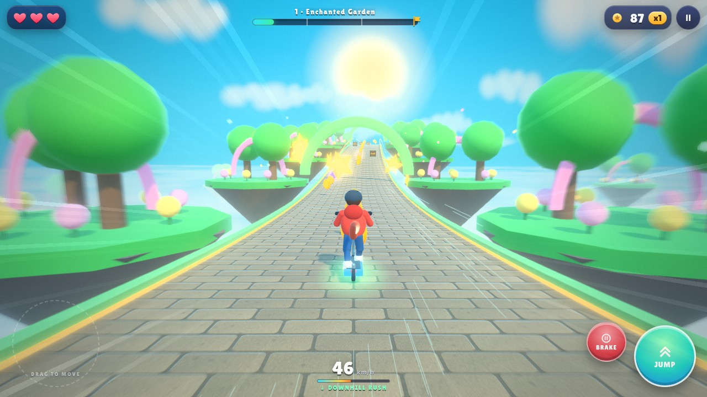
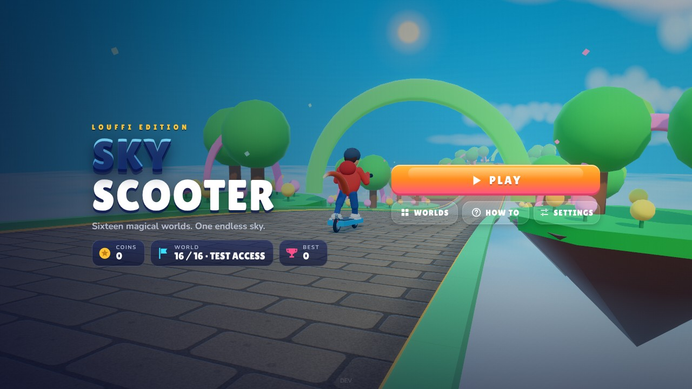
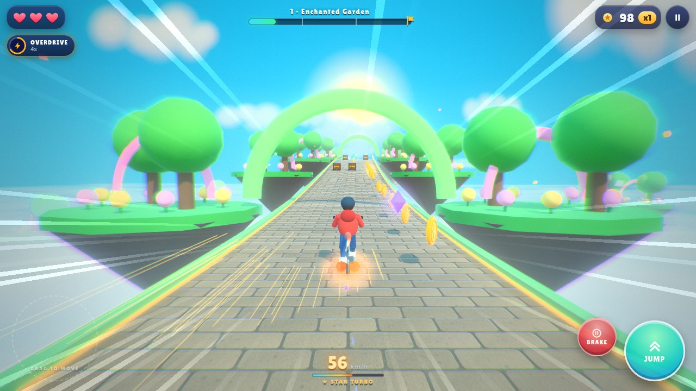
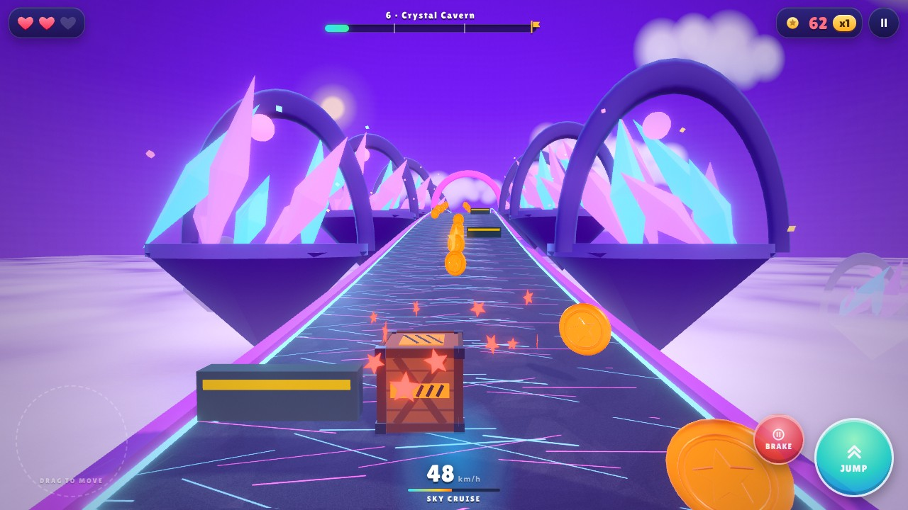
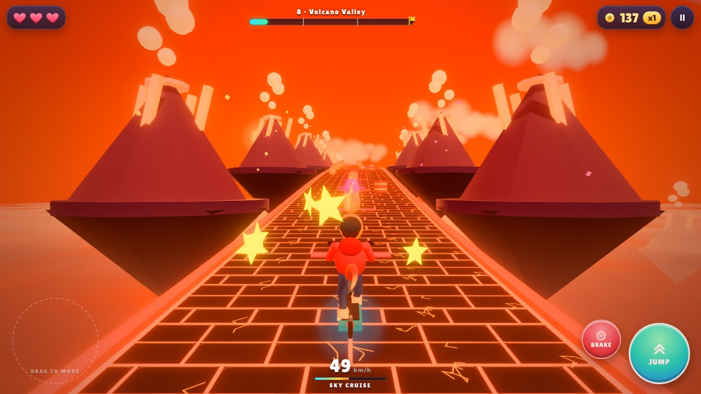
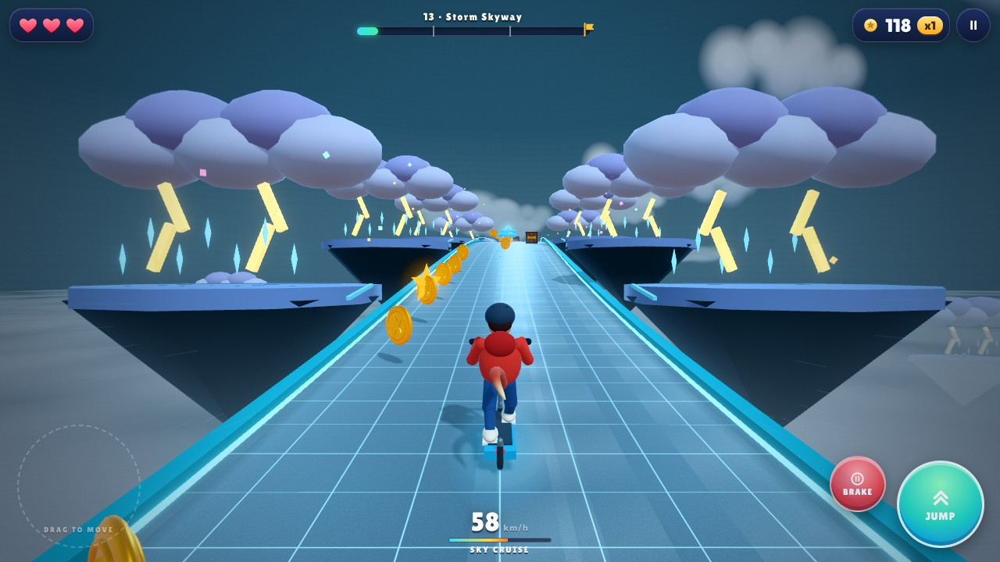
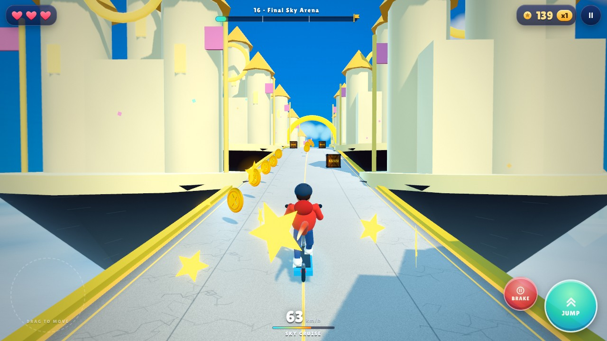
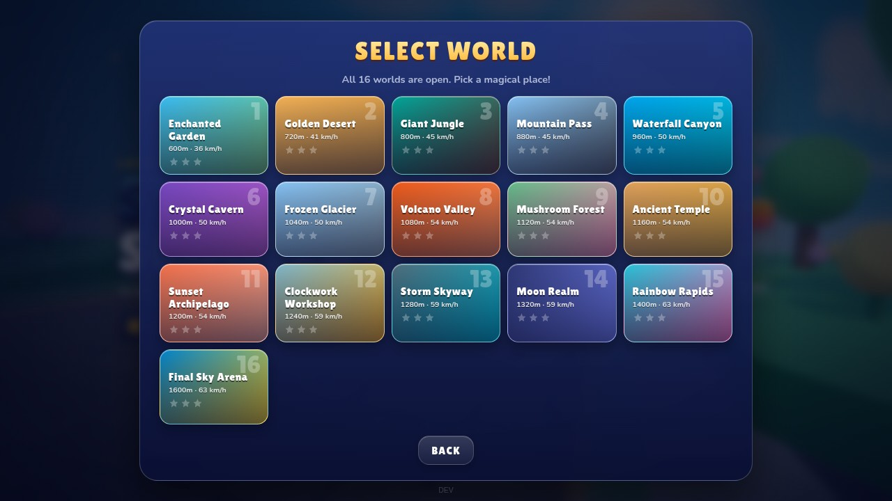
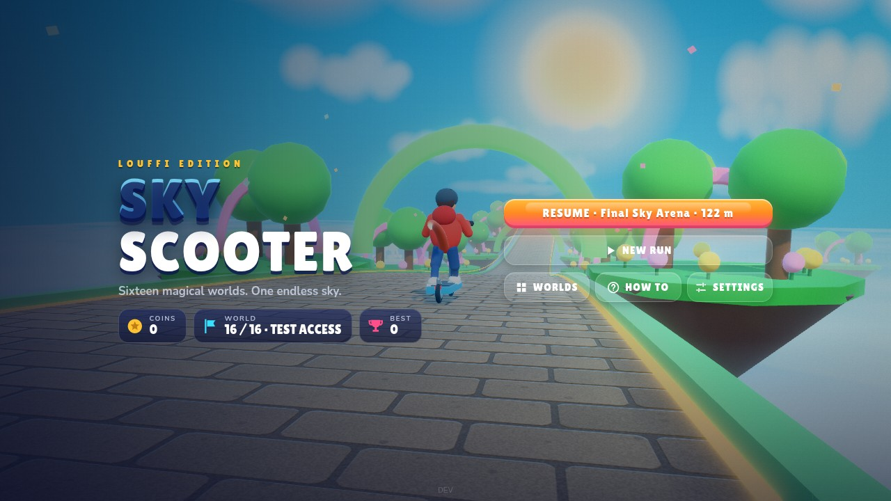

# SKY SCOOTER — LOUFFI EDITION

Offline 3D magical scooter runner for Android WebView and desktop browsers. The existing rider, scooter, four-way joystick, Jump, braking and camera behavior remain intact. Package identity, scores, settings and save keys are preserved.

## Cinematic graphics and pro controls

This release rebuilds how the game looks and feels without touching its rules, physics or save format.



| | |
| --- | --- |
|  |  |
|  |  |
|  |  |
|  |  |

*Real renders from `tools/render-shots.cjs` (software GL, 1280×720, High tier).*

### Rendering pipeline

```
scene ──► HDR target (RGBA16F, 4× MSAA on High) ──► dual-filter bloom (4–5 mips)
      ──► Khronos PBR Neutral tone map ──► per-world colour grade ──► vignette / speed blur /
          streaks / chromatic pulse ──► dither ──► canvas
```

| Piece | What it does | File |
| --- | --- | --- |
| Post-processing | Self-contained HDR pipeline (`three.min.js` ships no `EffectComposer`). Bloom keys off real HDR highlights: gems, glowing road inlays, the sun and turbo flames. 16 world grades (temperature, split-toning, contrast, saturation, vignette colour). Hit flash, pickup pulses, low-health edge pulse, sun shafts (kept off the rider so the hero always reads) and speed blur/streaks that respect **Reduced Motion**. | `js/postFx.js` |
| Graphics manager | GPU probe (Adreno / Mali / Immortalis / Xclipse / Apple, memory, cores), quality tiers, shadow set-up, dynamic resolution, framebuffer-completeness self-test with automatic fallback (MSAA → no MSAA → 8-bit target → direct render). | `js/graphics.js` |
| Material upgrade | One shader patch on the Standard/Lambert/Physical prototypes upgrades every material: sun-scattering atmospheric fog, height haze, sky-tinted fresnel rim, world-space colour variation and an optional curved horizon. Shared uniforms, no per-material cost. Opt out with `material.userData.noFx = true`. | `js/materialFx.js` |
| Road art | Sixteen procedural surfaces (cobble, planks, flagstone, sand ripples, cracked ice, lava plates, crystal veins, riveted metal, glass grid, moon craters, rainbow flow, marble, spotted moss, carved temple tiles) with bump and emissive maps, seamless along the route. Every route gets glowing edge inlays and curbs. Only the active surface stays in GPU memory. | `js/roadArt.js`, `js/enhancedTrack.js` |
| Lighting | Key light with a corrected shadow frustum (texel-snapped, so shadow edges never shimmer), hemisphere fill and a rim light that follows the visible sun. | `js/game.js` |
| Sky | HDR sun, shaded cloud puffs and an endless cloud sea beneath the route (two parallax layers on High). | `js/skyAtmosphere.js` |
| Rider FX | Height-aware contact shadow, state-coloured underglow (cruise, turbo, shield, antigravity, flight), take-off / landing / skid dust from a fixed particle pool. | `js/riderFx.js` |
| Collectibles | Beveled, embossed gold coin (one merged mesh), faceted crystal gem, additive halos on gems and power-ups. | `js/assetFactory.js` |

### Quality tiers and performance

| | Low | Medium | High |
| --- | --- | --- | --- |
| Post-processing | direct render (ACES) | HDR, 4-level bloom, FXAA | HDR, 5-level bloom, 4× MSAA, grain, chromatic pulse |
| Shadows | off (blob shadow only) | 1024 | 2048 |
| Pixel ratio cap | 1.0 | 1.5 | 2.0 |
| Cloud sea layers | 1 | 1 | 2 |

*Auto* (the new default) picks a tier from the GPU probe. **Dynamic resolution** keeps the frame rate smooth: sustained slow frames lower the scene render scale in 10 % steps down to 60 %, fast frames raise it again, and on *Auto* a struggling High tier demotes itself to Medium. Settings expose Quality, Cinematic Effects, Dynamic Resolution and a live FPS overlay. Settings written by older versions that say *High* (the old implicit default) are read as *Auto*; an explicit Low or Medium is kept. Game saves, scores and the wallet are untouched.

The three tiers are exposure-matched (a test checks their mean brightness), so switching quality never changes the art direction.

### Controls

- **Floating stick (default):** touch anywhere on the left half and the stick appears under your thumb. Dragging past the rim drags the base along, so overshooting never needs a long drag back.
- **Response curve:** 7 % steering dead zone, expo blend for fine control near the centre, full output slightly before the rim. The vertical axis has a larger (24 %) dead zone, so steering never accidentally accelerates or brakes. A ~20 ms filter removes touch jitter without perceptible lag; the newest coalesced sample is used for the lowest latency.
- **Jump anywhere on the right:** the whole right half is the jump button (hold in the air to glide). BRAKE is a separate button that never triggers a jump. Stick, jump and brake each own a pointer, so three fingers work independently; blur/app-switch releases everything.
- **Also:** fixed stick, **tilt steering** (steering-wheel style; the screen orientation is auto-detected and calibrated at the start of each run), left-handed layout, stick size and opacity, keyboard, and **gamepad** (left stick / D-pad, A or R2 jump, B or L2 brake, Start pauses).
- **Haptics:** light ticks for stick/jump/brake, a landing thud and pickup patterns. Strength is adjustable; on Android the pattern is played as an amplitude waveform (`AndroidBridge.vibratePattern`).

### Camera

Frame-rate independent smoothing, speed-driven FOV and pull-back, banking into turns, partial jump follow (the road stays in view), a damped landing-impact spring and a cinematic run-in during the countdown. **Reduced Motion** pins the classic rigid follow.

### HUD and menus

Glass HUD with SVG icons (no emoji), hearts that pop, a score count-up, combo pop, a progress bar with checkpoints and finish flag, timer-ring chips for every power-up, a speed read-out and a glide-ready ring on Jump. The HUD only writes changed values to the DOM and avoids `backdrop-filter` over the live canvas. Menus show a rider cruising the first world behind the logo; round cards use each world's colours; settings use proper switches and sliders. Fonts (Lilita One, Nunito; SIL OFL) are embedded as base64 (`npm run build:fonts`), so nothing loads from the network or from `file://`.

### Android

`MainActivity` re-applies immersive mode on focus, draws into display cutouts, excludes screen edges from system back gestures, holds the screen awake and requests sustained performance only while a run is active, plays haptic waveforms with amplitude control, locks WebView text zoom, disables the context menu, enables remote debugging in debug builds only, and declares `keyboard|navigation` config changes so connecting a gamepad does not recreate the activity. **These native changes were written without an Android SDK and have not been compiled or run on a device — build with `./gradlew assembleDebug` and test on hardware.**

## Arcade colors and turbo effects

The visual pass from [`scooter2` commit 7f60b85](https://github.com/salahlouffidi/scooter2/commit/7f60b8529a1996285172cfa60cbdf55de853cafb) is adapted into the official game: richer city palettes, a per-world post-processing colour grade, a bold speed badge with turbo/downhill states, twin exhaust flames and a small rainbow star trail. Flames follow the scooter's lean and slope; pickup bursts retain their gold color and normal size. All particles reuse the existing fixed pool.

Low graphics renders without post-processing and halves trail emission. Reduced Motion disables the flames, continuous trail and HUD pulse; pausing freezes the pulse. OS Reduced Motion also disables the HUD pulse. No additional GLB or runtime download is required.

## Rider tail and flight nitro

The original in-game rider now has a tapered orange tail with a cream tip, attached at the lower back. It sways while riding, bends behind turns, and extends during flight or turbo. The existing GLB is unchanged; a single mesh is added at runtime to both the GLB and fallback rider.

Sky Lift and airborne antigravity/gliding emit twin blue-purple nitro jets with bright cyan cores, matching sparks, and soft smoke. Boosting strengthens and lengthens the jets. Smoke stays behind in world space, expands and fades; ending powered flight stops emission while existing smoke dissipates. Grounded antigravity keeps its existing hover effect, and ground turbo retains its orange exhaust.

The smoke uses one draw call and a fixed pool of 64 particles. Low graphics reduces emission and lifetime. Reduced Motion disables flight exhaust and tail sway. Pause freezes the effects, and new runs or teleports clear stale smoke. Tail animation and exhaust do not change movement, collisions, power-up timers or saved physics.

See the actual game renders: [flight nitro](docs/nitro-flight.jpg), [rider tail detail](docs/rider-tail.jpg), and the [seven-second gameplay preview](docs/nitro-flight.mp4). Run `npm run test:flight:browser -- --record` to capture a scripted run showing takeoff, turns and landing; this capture is not a device performance measurement.

## Antigravity and gliding

Collect the purple gyroscope for **eight seconds of antigravity**. It first appears around 61 metres in every city, then repeats along the safe pickup lane. The scooter hovers, its wheels fold sideways, and purple rings and sparkles show the active power. Gravity drops to 22% and steering becomes quicker.

Tap **Jump** (or Space) to launch; **hold it while descending to glide**. Release it to descend faster. The joystick and Jump track separate fingers, so steering continues during a glide. Cars remain solid and rooftops support the hovering scooter. The existing Sky Lift can run alongside antigravity. Expiry restores normal gravity without snapping an airborne rider to the ground.

The HUD shows the remaining time and a glide hint. Pause, menu Resume and saved-run recovery preserve the timer and height; switching apps releases held controls. Older saves still load normally. Low graphics reduces particles and Reduced Motion keeps a steady hover ring without continuous trails.

## Resume your run

Use **RESUME** in the pause screen, or **RESUME · world · distance** in the main menu. **NEW RUN**, Retry and selecting another round deliberately start a new run.

- Menu navigation saves the current position, height, velocity, score, hearts, combo, collected items, power-up timers, checkpoint, traffic motion time and ML window.
- Track generation restores each visible segment's RNG state and difficulty, then continues the same future sequence. Collected items and hit obstacles are preserved.
- Saves occur every two seconds of play and immediately on pause, menu, visibility loss, page exit and native Android background callbacks.
- Android mirrors the snapshot in private SharedPreferences. WebView reload or Activity recreation offers the saved run from the menu.
- Returning from another app stays paused. Only an explicit Resume starts the countdown. Backgrounding during a countdown cancels it.
- Completed or failed runs clear the snapshot; the existing transaction ID prevents duplicate wallet rewards.

## Solid obstacles and collision penalties

All generated obstacles retain collision bounds from their actual factory meshes, including boxes, barriers, barrels and traffic. Physics uses substeps up to 1/120 second with swept lateral/forward checks and height-aware landing. Unprotected contact from the front, side or top costs **one heart and 50 points**, resets the coin combo, and shows the loss in the HUD. Scores stop at zero. Shields and magic guards absorb contact; obstacles remain solid during protection. Each obstacle charges once, including after saving and resuming, so staying against a box cannot drain every heart.

Clear the entire obstacle without touching it to earn the 50-point jump bonus. Landing on its roof counts as a hit. The round summary records actual obstacle deductions, and saved runs preserve them. The existing 70-point fall penalty is unchanged.

The four-way joystick remains: left/right steer, up accelerates, down brakes. Jump and the dedicated brake button remain available. Desktop: A/D or arrows, W/up, S/down, Space and Escape.

## Sixteen authored magical places

Each round has a distinct route surface, foreground silhouette, landmark family, lighting palette and gameplay profile. The repeated asphalt/shopfront layer has been removed.

| Round | Place | Main challenge |
| --- | --- | --- |
| 1 | Enchanted Garden | Gentle steering and simple obstacles |
| 2 | Golden Desert | Dunes and visible slowing sand patches |
| 3 | Giant Jungle | Fallen logs and winding paths |
| 4 | Mountain Pass | Narrow bridges and moving boulders |
| 5 | Waterfall Canyon | Marked jumps between ledges |
| 6 | Crystal Cavern | Crystal formations and moving obstacles |
| 7 | Frozen Glacier | Slippery steering on marked ice |
| 8 | Volcano Valley | Telegraphing lava hazards |
| 9 | Mushroom Forest | Bounce pads and aerial collectibles |
| 10 | Ancient Temple | Timed traps and stone platforms |
| 11 | Sunset Archipelago | Island crossings and landing accuracy |
| 12 | Clockwork Workshop | Moving machinery and timing |
| 13 | Storm Skyway | Bounded visible wind gusts |
| 14 | Moon Realm | Low-gravity jumps and floating rocks |
| 15 | Rainbow Rapids | Boost and glide combinations |
| 16 | Final Sky Arena | Fair combinations of learned challenges |

All rounds stay unlocked for testing. The continuous route remains authored and reachable; adaptive ML can only make bounded local adjustments inside each round's limits.

## Magic and adaptive difficulty

Gold stars give five-second turbo. Magic fruit gives ten seconds of turbo and two protected faults during that period. Sky Lift carries the rider above traffic and returns to the street. Wind and star particles are pooled; Reduced Motion reduces or disables continuous effects.

The local logistic model persists and chooses bounded difficulty for future segments. Its predicted clearance probability adjusts moving traffic and recovery pickup chances. It does not generate graphics or 3D models. Cold start and Adaptive OFF use fixed designer defaults. There are no cloud AI calls during gameplay.

## Assets and verification

The existing `models/louffi-world.glb` remains the single reusable Blender-compatible glTF asset for the rider and shared props. Magical scenery, road surfaces and route construction are generated from code. When layouts change, older active saves are deliberately migrated to the last safe checkpoint while scores, health, power-up inventory and run identity are preserved.

Serve `app/src/main/assets/game` with a local HTTP server. Run:

```sh
npm test                    # node: geometry, generators, physics, saves, effects (no browser)
npm run test:browser        # smoke + controls + graphics + antigravity + obstacles + session
node tools/flight-effects-browser.cjs
node tools/biome-preview.cjs
node tools/render-shots.cjs docs/shots 1280x720   # real renders of menu, HUD, worlds, modals
```

Browser scripts require Playwright and Chromium; set `CHROMIUM_EXECUTABLE_PATH` for an installed browser (they use SwiftShader, so frame rates in these tests say nothing about a phone).

- `tools/controls-browser.cjs` — CDP touch input: floating base placement, dead zone and expo curve values, follow-the-thumb, vertical dead zone, jump anywhere on the right, brake isolation, fixed/left-handed/size settings, tilt steering in both landscape orientations, keyboard, gamepad, haptic patterns and the vibration switch.
- `tools/graphics-browser.cjs` — tier configuration, HDR/MSAA/FXAA, brightness parity between tiers, LDR and direct-render fallbacks, dynamic-resolution governor, world grades, Reduced Motion, material patch and shader compilation, 16 distinct road surfaces, camera feel.
- The older suites (game, resume/physics, antigravity, flight effects, obstacle damage, sessions, all-16-world previews) still run unchanged apart from assertions that named the old CSS colour filter and emoji hearts.

`npm test` runs the game, collision/resume, antigravity, flight-effects and obstacle-damage checks. Obstacle coverage includes generated hazards in all 16 worlds, all 12 GLB/fallback types, front/side/top/turbo contact, shields, guards, score floors, clean jumps and saved hit state. `npm run test:antigravity:browser` checks two simultaneous touch pointers, hold/release gliding, keyboard repeat, cancellation, app-switch pausing, purple effects and phone HUD layout. `npm run test:flight:browser` renders the rider tail and nitro, checks GPU shader compilation, landing fade and Reduced Motion, and writes the two preview images above.

This is a Three.js mobile visual upgrade, not a PS5-class renderer. Real Android frame rate, thermal behaviour, memory pressure recovery and the native Activity lifecycle still require device testing; the quality tiers and dynamic resolution exist precisely because phones differ. No signed APK/AAB is included in this commit.

## Clearer gameplay view

Pickup rewards and obstacle penalties update the score in the top HUD immediately. Gold/red color feedback replaces floating numbers and damage text; brief checkpoint/guard notices also stay at the top. Compact, accessible power-up timers fit phone screens without a tall stack over the route.

Boost blur, color separation and streaks are restricted to the screen edges. A satin crystal surface reduces the white glare ahead of the rider. Smaller collectible halos, restrained sun shafts and softer side wind keep the forward road readable while preserving the HDR lighting, biome surfaces, rider tail and flight exhaust. Low/Medium/High rendering and Reduced Motion remain supported.

Verify with `npm test`, `npm run test:hud:browser`, `npm run test:graphics:browser` and `npm run test:obstacles:browser`. Browser suites accept `CHROMIUM_EXECUTABLE_PATH`. The graphics suite compares calm/boosted framebuffer pixels to check road clarity; the HUD suite exercises real pickups, burst rewards, penalties, all seven power-ups on phone layouts and legacy save migration.

Actual gameplay previews: [Garden boost](docs/clarity/r1_turbo.jpg) · [Crystal road and hazards](docs/clarity/r6.jpg).
