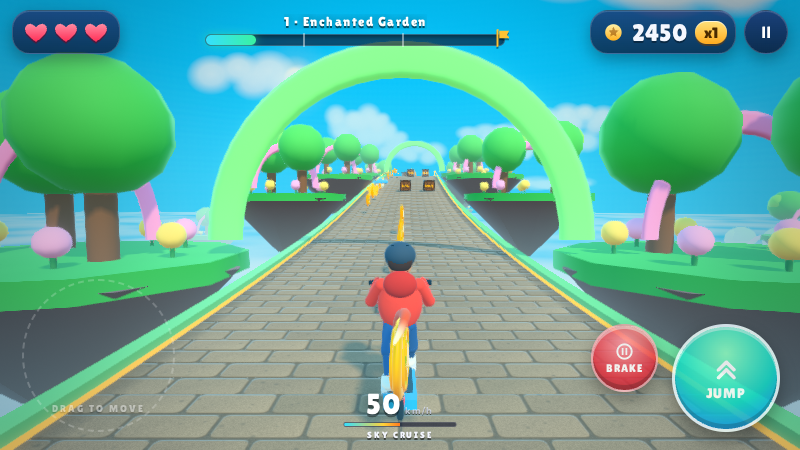
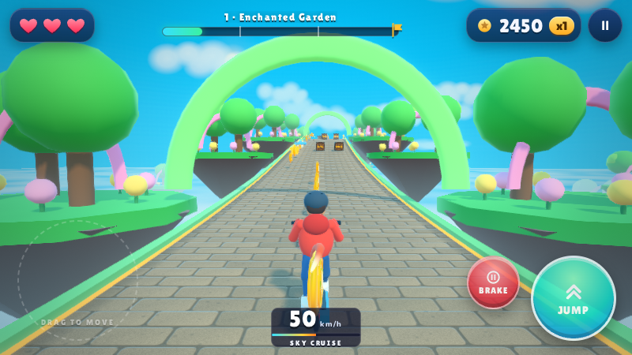
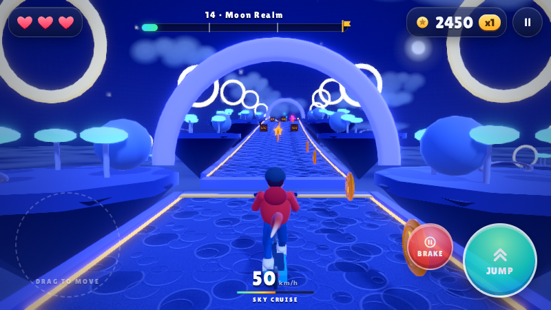
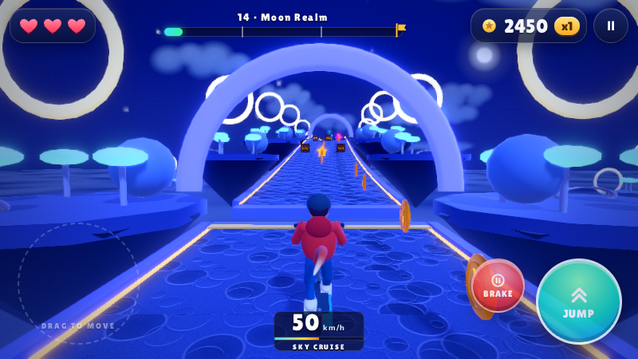
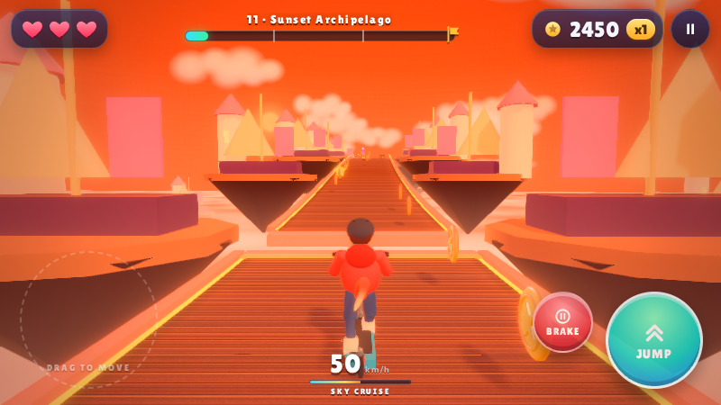
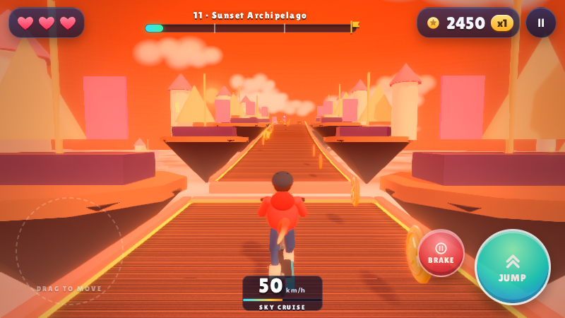
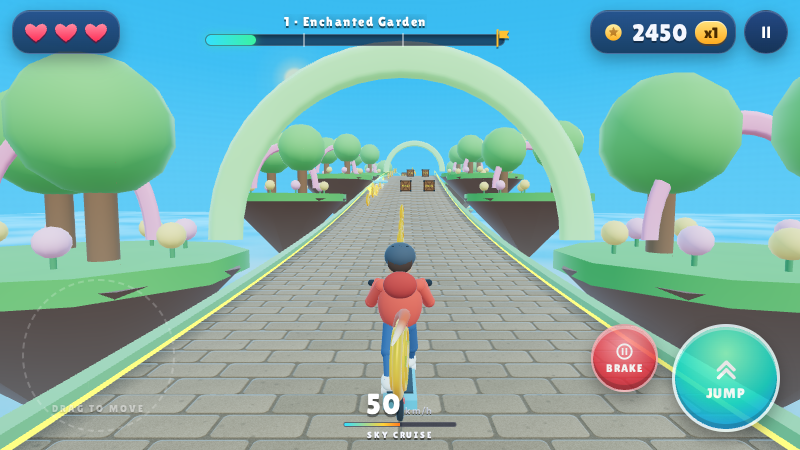
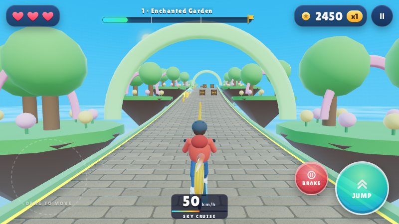
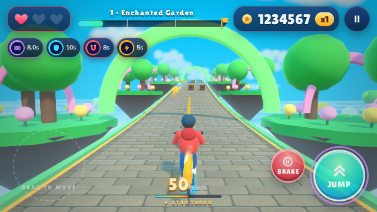
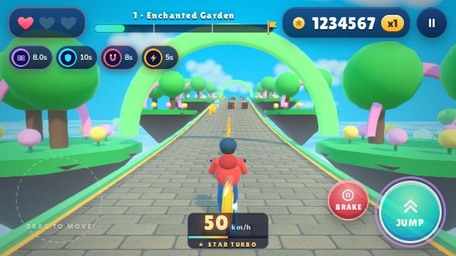

# Careful visual polish review

Baseline: latest `main` at `b985668f49d9cddb6005d73d36915e671d4c4ef0`, inspected and preserved before editing. Candidate branch: `visual/clarity-polish-b985668`. The visual implementation is isolated in commit `de1f1aa`; reverting that commit restores both production files without needing to remove the review evidence. No older experimental branch was merged, and main was not pushed or merged by this task.

## Preserved working version

The local backup branch is `backup/main-before-visual-2026-10-30-b985668`. A verified, complete-history repository bundle named `scooter-main-b985668.bundle` is supplied separately. The baseline capture was made from a fresh archive of that exact commit, not from an experimental branch or the edited working tree.

## What was actually inspected

Actual game WebGL frames were rendered from the repository assets in Chromium, with the real GLB kit loaded. Inspection covered Enchanted Garden, Moon Realm, Sunset Archipelago, the direct low-quality fallback, and a 640×360 landscape view with a seven-digit score, one heart and stacked power-ups. The existing low-poly floating-world identity, red rider, navy/cyan HUD, obstacle silhouettes and forward sightline already read reasonably well; they were not replaced.

Two small issues were selected. The very amber key light in the sunset view adds an orange cast to nearby rider/prop materials in addition to the already orange sky, fog and rim. The tiny speed unit/status text competes with the bright stone/wood road beneath it, especially on the smaller landscape view. No clipping, collision-related overlap, flickering or glare defect was confirmed strongly enough to justify a geometry, shadow, camera or effects change.

## Exactly what changed

**Warm-key color balance — `game.js`.** The existing warm-world directional key changed from `0xffc48f` to the creamier `0xffd8ad`. This is deliberately a subtle color correction, not a new lighting rig or a major reduction of the warm palette. The shared warm branch applies to sunset, desert and volcano; the supplied warm screenshot is Sunset Archipelago. The orange sky/fog, warm rim, light positions, intensities, exposure and all post-processing presets remain unchanged. Day, storm and night key colors are unchanged. No light, material, mesh, texture, render pass or effect was added.

**Speed HUD contrast — `game.css`.** The existing bottom-center speed element gets a translucent navy fill, rounded corners and an inset stroke matching the existing HUD language; the `km/h` label gets a slightly lighter color. There is no extra padding, border box, overlay element, larger panel, backdrop blur, new animation or pointer target. The backing quiets the small road strip already occupied by that readout; its bounds and touch behavior remain the same. Forward obstacles and the rider remain unobstructed by any enlarged UI. Existing turbo feedback and quality/reduced-motion rules are preserved.

The production diff is only two files: **6 added lines and 2 replaced/deleted lines**. The screenshot/counter tools and this review evidence are separate, non-shipping artifacts.

## Matching before/after scenes

These are actual game screenshots, not mockups or AI-edited images. Each pair has the same round, procedural seed `20261030`, route position 100 m, rider state, camera, sun/light positions, viewport, quality tier, DPR 1 and fixed visual time. Adaptive resolution is pinned only inside the capture harness so the pair is comparable; normal game behavior is unchanged. The small-HUD pair has Reduced Motion enabled. The existing test-only round-start bypass is used to inspect locked worlds without changing saved progression.

| Scene | Before | After |
| --- | --- | --- |
| Garden · medium · 800×450 |  |  |
| Moon Realm · medium · 800×450 |  |  |
| Sunset · medium · 800×450 |  |  |
| Garden · low/direct · 800×450 |  |  |
| Small landscape HUD · medium · 640×360 · Reduced Motion |  |  |

Capture metadata and comparisons are provided alongside the images. Matching is checked programmatically, including track-state hashes, rider/camera/light poses, HUD rectangles/text, and render-resource counters. The tools are not referenced by the game HTML and are not packaged into the app.

## Performance: measured counters, not phone FPS

The measured renderer was desktop Linux Chromium using ANGLE/Vulkan **SwiftShader software rendering**. The evidence records Three.js scene render counters, including the scene's existing shadow work; it is not a phone GPU benchmark. Matching pairs added **zero draw calls, triangles, textures or geometries**, and HUD dimensions did not grow. A light color changes an existing uniform and the HUD uses a static background with no backdrop filter.

| Captured scene | Scene calls before → after | Triangles before → after | Textures before → after | Geometries before → after |
| --- | ---: | ---: | ---: | ---: |
| Garden medium | 645 → 645 | 183,508 → 183,508 | 21 → 21 | 104 → 104 |
| Moon medium | 580 → 580 | 155,478 → 155,478 | 21 → 21 | 126 → 126 |
| Sunset medium | 566 → 566 | 118,434 → 118,434 | 21 → 21 | 120 → 120 |
| Garden low/direct | 383 → 383 | 109,892 → 109,892 | 7 → 7 | 72 → 72 |
| Small HUD medium | 645 → 645 | 183,508 → 183,508 | 21 → 21 | 104 → 104 |

See [matching/counter JSON](evidence/comparison.json), [preservation checks](evidence/preservation-checks.json), and [release APK/native test checks](evidence/android-artifact-checks.json).

There is no measured frame-rate improvement, frame-time benchmark, battery/thermal measurement or physical-phone result. CSS painting/compositing time is not measured by Three.js counters. Unchanged resource counts and successful quality tests reduce regression risk but do not guarantee identical performance on every device. The normal adaptive-resolution and Reduced Motion switches remain intact and were exercised by the existing browser checks.

## Strict preservation checks

A byte-comparison against the preserved baseline checked 76 protected tracked files with no differences. All of `game.js` outside the single light-color replacement/comment is identical to baseline, including ad requests/callbacks, UMP-facing bridge calls, Game Over, rewarded revive, physics, collision handling, controls, difficulty, scoring and progression. Control CSS blocks and reduced-motion rules are unchanged.

Native ad/consent sources, App ID `ca-app-pub-3521560929268417~8016739665`, interstitial `ca-app-pub-3521560929268417/9134380216`, rewarded `ca-app-pub-3521560929268417/3871153080`, SDK/dependency versions, signing configuration, ProGuard and optimized-release configuration are unchanged from **latest main**, including its existing ProGuard cleanup. This task did not reinstate older release rules or merge old ad experiments.

## Actual checks run

- `npm test`: all five offline suites passed on baseline and candidate, covering assets/rounds, controls/physics/scoring, saved-run restoration, antigravity, flight effects and obstacle damage.
- `node tools/verify-ad-flow.cjs`: passed on the candidate, including immediate Game Over, unavailable messaging, stale/duplicate callbacks, exactly one earned one-heart revive and revive-limit persistence across recreation.
- Existing browser graphics checks: passed, including high/medium/low tiers, HDR/MSAA/FXAA, direct/LDR fallback, exposure parity, dynamic resolution, material compilation, all 16 road surfaces and Reduced Motion.
- Existing browser HUD checks: passed, including real pickup scoring, bounded HUD DOM, large score/seven power-ups fitting landscape/portrait viewports, Reduced Motion and legacy-save notices.
- Native selected tests: all 10 injected-loader ad tests and the ordinary unit test passed. These are simulated SDK callbacks, not ad serving or phone testing. The unrelated API 36/native-graphics tests were not rerun in this visual task; the ARM64 runtime limitation from the ad investigation is not claimed resolved.
- `:app:assembleRelease :app:lintRelease`: passed with existing R8 minification and resource shrinking; lint reported 0 errors and 65 warnings. A temporary external self-signed verification key was used, not a production key. No key or binary is committed, and no production signing/upgrade success is claimed.
- Release APK inspection: packaged `game.js` and `game.css` match candidate source byte-for-byte, both production units remain in DEX, ad diagnostics remain, and APK v2 signature verification passed using the temporary key.
- JavaScript syntax and `git diff --check`: passed. Independent read-only review found no actionable ad/gameplay/control/build-boundary regression.

The initial controls browser attempt timed out waiting for MENU while browser captures and Gradle were running concurrently. The unchanged controls suite **passed on both baseline and candidate when run standalone**, each with exit 0. The final five captures and strict matching comparator also completed with exit 0. The earlier startup timeout is retained in the evidence rather than silently discarded. No game timing or test source was changed to work around it.

## Reproduce and remaining review

Use the existing Node/Playwright setup; no dependency manifest or lockfile was changed. The screenshots were captured using an already installed Playwright 1.64.1 outside the repository. On a supported test machine:

```sh
node tools/visual-review.cjs /tmp/visual-after
node tools/compare-visual-review.cjs /tmp/visual-before/scenes.json /tmp/visual-after/scenes.json
npm test
node tools/verify-ad-flow.cjs
node tools/graphics-browser.cjs
node tools/hud-clarity-browser.cjs
node tools/controls-browser.cjs
```

Review the modest warm tint and translucent speed backing before merging. Physical-device checks still needed include low/medium/high/auto performance on representative phones, portrait/landscape safe areas, speed-panel legibility while moving, warm desert/volcano visual balance, Reduced Motion and an optimized production-signed build. If exercising ads, use registered test devices and confirm the unchanged consent/Game Over/rewarded flow; no real/test ad requests were made here. Main remains unchanged pending the user's visual approval.
